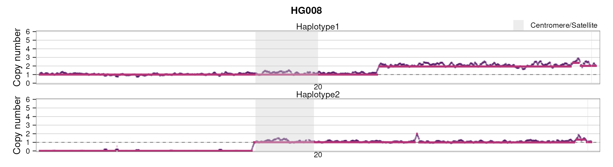

# Example

This page walks through an end-to-end PRCGAP run on a public tumor / normal pair, restricted to **chromosome 20** so the dataset is small enough to drive on a single workstation. The sample is **HG008** — a broadly-consented matched tumor / normal pair (pancreatic ductal adenocarcinoma cell line and matched normal tissues) developed by NIST's [Cancer Genome in a Bottle](https://www.nist.gov/programs-projects/cancer-genome-bottle) project and characterised in [McDaniel *et al.*, *Scientific Data* (2025)](https://doi.org/10.1038/s41597-025-05438-2). It uses `HG008-T` (tumor) and `HG008-N` (normal) PacBio HiFi and ONT-UL reads from the GIAB FTP, together with a Verkko 2.2 diploid assembly of HG008-N released by the same project. See [References](#references) at the bottom for the full citations.

The walkthrough assumes that:

- The host prerequisites are installed (Snakemake 7.x, Apptainer / Singularity; cookiecutter for clusters) — see [Usage → Installation](./Usage.md#installation). Cloning the repository and pulling the images is [step 0](#_0-clone-prcgap-and-pull-the-container-images) below.
- Apart from step 0, all commands run from **`PRCGAP/test/HG008/`**, which ships with:
  - `test_configure.sh` — wraps `setup_workflow.py` with every flag wired to the test fixtures.
  - `resources/scripts/download_data.sh` — fetches the reads and the matched HG008N haplotype assemblies.
  - `resources/scripts/extract_chr20_reference.sh` — cuts the genome-wide references down to chr20.
  - `resources/scripts/download_annotation.sh` — fetches the external annotation resources (CMRG, gnomAD).
  - `resources/annotation/HG008N.*` — the pre-built chr20 annotation fixtures.
  - `resources/scripts/README.md` — full per-script inventory, source URLs, and output paths.

> **Required tools on `PATH`.** The download / preparation helpers in steps 1–3 need a few command-line tools on the host (the pipeline itself runs everything in containers):
>
> | Tool | Used by | Purpose |
> |---|---|---|
> | `python3` | `download_annotation.sh` and its helpers | Filtering the CMRG table |
> | `wget` | all three download helpers | Fetching reads, references, and annotation resources |
> | `samtools` | `download_data.sh`, `download_reference.sh`, `extract_chr20_reference.sh` | `view -F 2308` for chr20 slicing, `faidx` for indexing and extracting contigs |
> | `bgzip` / `tabix` | `download_annotation.sh`, `download_reference.sh` | Block-gzip compression and indexing |
>
> `which python3 wget samtools bgzip tabix` should print a path for each before you start.

## 0. Clone PRCGAP and pull the container images

```bash
git clone https://github.com/yos-sk/PRCGAP.git
(cd PRCGAP/images && bash pull_images.sh)
cd PRCGAP/test/HG008
```

See [Usage → Installation](./Usage.md#installation) for the full detail (prerequisites, the image list, overriding individual images). Pulling and converting the images takes about **30 minutes**.

## 1. Fetch reads and assemblies

From `test/HG008/`, run the data-download helper (it `cd`s into its own directory). It pulls the GIAB HG008-T / HG008-N ONT-UL and PacBio HiFi BAMs (CHM13v2.0-aligned), slices each to chr20 with `samtools view -F 2308` (dropping unmapped, secondary, and supplementary alignments), and fetches the matched Verkko 2.2 hap1 / hap2 assemblies of the normal, extracting `haplotype1-0000020` and `haplotype2-0000110` — the chr20 contigs:

```bash
(cd resources/scripts && bash download_data.sh)
```

After it completes:

```
test/HG008/resources/
├── reads/
│   ├── ont/HG008{T,N}.chr20.ont.bam
│   └── hifi/HG008{T,N}.chr20.hifi.bam
└── asm/
    ├── HG008N.hap{1,2}.fa{,.fai}      # full assembly (kept so faidx can resolve the chr20 contig)
    └── HG008N.hap{1,2}.chr20.fa
```

> **Note** — both the tumor and the normal rows of the sample sheet use the **same** haplotype assemblies (built from the matched normal); this is the standard PRCGAP convention for tumor / normal pairs.

## 2. Fetch and trim the reference genomes

First fetch the genome-wide references into the repository's `resource/reference/` (this is the same one-time step every PRCGAP installation needs — see [Quick start → step 3](./QuickStart.md#_3-fetch-the-references-once-per-installation)):

```bash
bash ../../resource/scripts/download_reference.sh
```

Then cut them down to chr20 for this test case:

```bash
(cd resources/scripts && bash extract_chr20_reference.sh)
```

The assembly is chr20-only, so aligning it against 3 Gb of reference is waste: the minimap2 index dominates both `liftoff_hap` and `chain_files_hap`, and restricting the reference makes it roughly 1/50 the size. The GTF has to be cut as well — with a chr20-only FASTA, liftoff would still try to lift every other chromosome's genes and find no sequence for them.

Outputs. Every cut carries a **`_chr20` suffix**, so a chr20 slice can never be mistaken for the genome-wide original it came from:

```
test/HG008/resources/reference/
├── chm13v2.0_maskedY_rCRS_chr20.fa{,.fai}                        # T2T-CHM13 v2.0
├── GRCh38.d1.vd1_chr20.fa{,.fai}                                 # GRCh38.d1.vd1
├── Homo_sapiens.GRCh38.Ensembl.112.chr.format_chr20.gtf          # gene models
├── chm13v2.0_censat_v2.1_chr20.bed.gz{,.tbi}
├── centromeres_chr20.txt.gz
└── GCA_000001405.15_GRCh38_GRC_exclusions_T2Tv2_chr20.bed
```

`test_configure.sh` points at these suffixed names. The genome-wide originals stay in `PRCGAP/resource/reference/`, where `download_reference.sh` wrote them, and are read from there by every other run in the repository; `--mane-summary` is read from there directly too, since it is not coordinate-based and needs no cut.

## 3. Prepare annotation files

The test consumes two groups of annotation resources with different provenance.

### 3a. Haplotype-derived annotations: shipped with the repository

The chr20 versions of the per-assembly annotation are distributed with PRCGAP, under `test/HG008/resources/annotation/`, so **no action is required**:

| Fixture | Passed as |
|---------|-----------|
| `HG008N.hap{1,2}_dna-brnn.bed.gz{,.tbi}` | `--hap1-satellite` / `--hap2-satellite` |
| `HG008N.simple_repeats.bed.gz{,.tbi}` | `--simple-repeat` |
| `HG008N.LINE1.bed.gz{,.tbi}` | `--line1-bed` |
| `HG008N.to_{grch38,chm13}.chain` | `--chain-to-grch38` / `--chain-to-chm13` |
| `HG008N.rmsk.bed.gz{,.tbi}` | `--repeat-masker-bed` |
| `HG008N.segdup.bed.gz{,.tbi}` | `--segdup-bed` |
| `HG008N.censat.bed.gz{,.tbi}` | `--censat-bed` |
| `HG008N.misassembly_hap{1,2}.bed.gz{,.tbi}` | `--misassembly-hap{1,2}-bed` |

Using fixtures for the first four keeps this test focused on the calling pipeline: `test_configure.sh` passes `--no-run-dna-brnn --no-run-chain-files --no-run-line1 --no-run-simple-repeat` so the workflow imports them instead of rebuilding them. The last four are the deeper annotation PRCGAP never builds ([Preparation §3](./Preparation.md#_3-optional-deeper-annotation)).

The gene annotation has no fixture and no switch — liftoff always runs, which is why step 2's GRCh38 FASTA and GTF are required.

### 3b. External annotations: downloaded

CMRG gene list and gnomAD v4.1 SV + SNV/INDEL sites:

```bash
(cd resources/scripts && bash download_annotation.sh)
```

This writes `cmrg_genes.list`, `gnomad.v4.1.sv.sites.bed.gz{,.tbi}`, and `gnomad.genomes.v4.1.sites.chr20.vcf.bgz{,.tbi}` under `resources/annotation/` — the three files `test_configure.sh` passes on. The Python helpers `extract_cmrg_gene.py` and `proc_gencode_bed_mane_chr20.py` live next to the script and are invoked automatically; the latter's GENCODE/MANE transcript BED is a leftover from an earlier annotation route and is no longer consumed (`--mane-summary` replaced it).

### 3c. Manual: Cancer Gene Census

The Cancer Gene Census requires a COSMIC account and is **not** downloaded by the helpers. After registering at <https://cancer.sanger.ac.uk/cosmic/download/cosmic/v104/cancergenecensus>, place the TSV at:

```
test/HG008/resources/annotation/cancer_gene_census.tsv
```

Or drop `--cancer-gene-census-tsv` from `test_configure.sh` and run without it — the `cgc` column is then filled with the not-evaluated placeholder. See `resources/scripts/README.md` for the full per-file source table.

## 4. (Optional) Author a Snakemake profile for HPC

This section is only for SLURM or SGE/UGE clusters. On a single workstation you can **skip it entirely**. The full walkthrough — template choice, the 17 interactive prompts, and the jobscript patch that pins each job's cores to its allocation — is in [Usage → cluster profile](./Usage.md#optional-but-recommended-author-a-cluster-profile-with-cookiecutter):

```bash
cookiecutter --output-dir ../../profile gh:Snakemake-Profiles/slurm   # or .../sge
```

::: warning `test_configure.sh` ships with `--profile ../../profile/slurm`
The profile directory is site-specific and is not distributed with the repository, so that path does not exist in a fresh clone. **Point it at the profile you scaffolded above, or delete the `--profile` line** to run locally.
:::

## 5. Generate `config.yaml` and the runner

`test_configure.sh` is a thin wrapper around `setup_workflow.py` that points every read, reference, annotation, image, and resource flag at the files produced by the preceding steps, and sizes each rule for chr20 rather than for a whole genome. Run it from `test/HG008/`:

```bash
bash test_configure.sh
```

It writes:

- `config/samples_HG008.tsv` — the sample sheet (written by the `--tumor` / `--normal` options; there is no separate sheet step)
- `config/config_HG008.yaml` — the resolved workflow config
- `run_HG008.sh` — the runner script
- `./HG008/` — the output directory

Before running it, check three things in the script:

1. **`--singularity-bind`** — it defaults to `$HOME` (plus `$HOME`'s symlink target, if it is one). Extend it to cover every filesystem root your reads, references, and output directory live under. See [Usage → `--singularity-bind`](./Usage.md#bind-mounts).
2. **`--profile`** — see the warning in step 4.
3. **`--sex female`** — matches HG008's donor sex. `--copynumber-plot-sex-chrom false` keeps chrX / chrY off the plot, since this is a chr20-only run.

Two environment switches change what the run exercises:

```bash
MUTATION_CALLER=clairs bash test_configure.sh   # ClairS instead of DeepSomatic
MUTATION_CALLER=both   bash test_configure.sh   # both callers, cross-checked
```

Point-mutation calling runs on HiFi only, because `--mutation-seqtypes` defaults to `primary`. Add `--mutation-seqtypes all` to call on ONT as well. To attach or detach an individual annotation resource, comment out its flag — every one listed in [Options → Variant-annotation resources](./Options.md#variant-annotation-resources-all-optional) is optional, so removing a line just skips that column.

## 6. Run the workflow

```bash
bash run_HG008.sh
```

On an HPC cluster (jobs submitted through a Snakemake profile) the full chr20 walkthrough takes roughly **1–2 hours** end-to-end, measured. Wall-clock time varies with scheduler queueing and the per-rule resources you allocate; a single workstation, where rules run sequentially rather than in parallel, will be slower.

## 7. What a finished run produces

Outputs land under `test/HG008/HG008/` (the `--output-dir` in `test_configure.sh`). The listing below is an actual completed run of the default configuration: HiFi + ONT reads, DeepSomatic, point mutations on HiFi.

```
test/HG008/HG008/
├── annotation/
│   ├── references/liftoff/GRCh38.{fa,fa.fai,gtf,gtf_db}
│   └── HG008N/liftoff/HG008N.liftoff.gff.gz{,.tbi}
│                      HG008N.liftoff.gtf.gz
│
├── bam_refiner/
│   ├── HG008N/hifi/HG008N_bam_refined.sorted.bam{,.bai}
│   │                HG008N_kmer_ratio.txt
│   │                bam_refiner_result.tsv.gz, bam_refiner.log.gz
│   ├── HG008N/ont/  (same five files)
│   ├── HG008N/kmer/hap{1,2}_cnt_kmerposition.bed.gz{,.tbi}
│   │                hap{1,2}_list.txt.gz
│   └── HG008T/{hifi,ont}/  (same five files each)
│
├── methylation/
│   ├── HG008{T,N}/hifi/output/HG008{T,N}_methylation.{combined,hap1,hap2}.bed.gz{,.tbi}
│   │                            HG008{T,N}_methylation.{combined,hap1,hap2}.bw
│   └── HG008{T,N}/ont/output/  HG008{T,N}_methylation.bed.gz{,.tbi}
│
├── copynumber/HG008T/output/
│       HG008T.copynumber.png                    ← the plot below
│       HG008T.hap{1,2}.copynumber.tsv
│       HG008T.hap{1,2}.cbs.txt
│       HG008T.hap{1,2}.cbs.split.txt
│       HG008T.hap{1,2}.ploidy
│       HG008N.hap{1,2}.ref.table
│
├── nanomonsv/{hifi,ont}/
│       HG008{T,N}.{bp_info,deletion,insertion}.sorted.bed.gz{,.tbi}
│       HG008{T,N}.rearrangement.sorted.bedpe.gz{,.tbi}
│       HG008T.nanomonsv.result.txt, .result.vcf
│       HG008T.nanomonsv.supporting_read.txt, .sbnd.result.txt
│       HG008T.simple_repeat_scores.tsv
│       HG008T.nanomonsv.result.filt.txt
│       HG008T.nanomonsv.new_result.sv_typed.txt
│       HG008T.nanomonsv.{group,pair}_info.txt
│       HG008T.nanomonsv.new_result.sv_typed.insert_classified.txt
│
├── deepsomatic/HG008T/hifi/output.vcf.gz{,.tbi}
├── deepsomatic_post/HG008T/hifi/
│       HG008T.haplotyped.bed
│       output.vcf.gz, output.tabix.vcf.gz{,.tbi}
│       pileup/HG008T_pileup.bed.gz{,.tbi}
│       realign/realign.bam{,.bai}, realign/parsed_vcf.bed
│       haplotyping.log
│
├── annotate_common/HG008N/liftoff.gene.bed.gz{,.tbi}
├── annotate_sv/HG008T/{hifi,ont}/
│       HG008T.PRCGAP.nanomonsv_results.annotated.txt
│       HG008T.PRCGAP.nanomonsv_results.annotated_gnomad.txt
│       HG008T.PRCGAP.nanomonsv_results.reclassified.txt
├── annotate_snv/HG008T/deepsomatic/hifi/HG008T.deepsomatic.snv.annotated.txt
├── annotate_indel/HG008T/deepsomatic/hifi/HG008T.deepsomatic.indel.annotated.txt
│
├── benchmarks/<module>/…      # per-rule wall time and peak RSS
└── logs/<module>/…            # per-rule logs (+ logs/slurm/<rule>/<jobid>.{out,err})
```

The four final callsets:

| Result | Path |
|--------|------|
| Copy number | `copynumber/HG008T/output/HG008T.copynumber.png` and `HG008T.hap{1,2}.cbs.txt` |
| Structural variants | `annotate_sv/HG008T/{hifi,ont}/HG008T.PRCGAP.nanomonsv_results.reclassified.txt` |
| SNVs | `annotate_snv/HG008T/deepsomatic/hifi/HG008T.deepsomatic.snv.annotated.txt` |
| INDELs | `annotate_indel/HG008T/deepsomatic/hifi/HG008T.deepsomatic.indel.annotated.txt` |

Note what is **not** in the tree: `annotation/HG008N/{dna_nn,line1,simple_repeat,chain_files}/` is absent because this configuration imports those four from the fixtures instead of building them; every `workspace/` directory, `deepsomatic_scatter/`, `bwa_index/`, and `copynumber/reference/` are gone because PRCGAP deletes the scratch a successful run no longer needs (pass `--debug` to keep it). See [Workflow → Scratch removed on success](./Workflow.md#scratch-removed-on-success).

### The copy-number plot

`copynumber/HG008T/output/HG008T.copynumber.png` from the run above:



One panel per haplotype, x-axis in chr20 coordinates, with the centromere / satellite interval shaded. The dashed line is the estimated tumor ploidy per haplotype (1 for both here, from `HG008T.hap{1,2}.ploidy`); the dark trace is the per-bin copy number from `HG008T.hap{1,2}.copynumber.tsv` and the flat magenta line the CBS segmentation from `HG008T.hap{1,2}.cbs.txt`. Haplotype 1 gains a copy across the distal half of the q arm while haplotype 2 is lost across the p arm — the kind of haplotype-resolved asymmetry that a diploid-reference pipeline would report as a single averaged trace.

The centromeric shading is where `--chm13-censat` earns its keep: the personalized assembly leaves gaps there, and the CHM13 reference satellite annotation fills them so the plot renders continuously instead of showing spurious dropouts. Panel labels come from `--copynumber-hap{1,2}-label`.

## 8. Variants of the test run

The published `test_configure.sh` covers the HiFi + ONT, fixture-annotation case. Three edits turn it into the other configurations:

### HiFi-only or ONT-only

Delete the read flags for the seqtype you want to drop:

```bash
# HiFi-only: remove these two lines
    --tumor-ont   resources/reads/ont/HG008T.chr20.ont.bam \
    --normal-ont  resources/reads/ont/HG008N.chr20.ont.bam \

# ONT-only: remove these two instead
    --tumor-hifi  resources/reads/hifi/HG008T.chr20.hifi.bam \
    --normal-hifi resources/reads/hifi/HG008N.chr20.hifi.bam \
```

Also change `--output-dir`, `--output`, and `--runner` so the variant gets its own directory and config. In the HiFi-only run the `ont` branches simply disappear from the tree — no `bam_refiner/*/ont/`, no `methylation/*/ont/`, no `nanomonsv/ont/`, no `annotate_sv/HG008T/ont/`. The ONT-only run is the mirror image, with point mutations and copy number falling back to ONT since it is then the only shared seqtype. If you also switch to ClairS, add `--clairs-model ont_r10_dorado_sup_5khz_ssrs`.

### Minimal inputs: let PRCGAP build the annotation

To exercise the in-workflow annotation instead of the fixtures, swap the four switches and drop the four fixture paths they supersede:

```bash
# replace
    --no-run-dna-brnn --no-run-chain-files \
    --no-run-line1 --no-run-simple-repeat \
# with
    --run-dna-brnn --run-chain-files \
    --run-line1 --run-simple-repeat \
    --grch38-centromeres resources/reference/centromeres_chr20.txt.gz \
    --grch38-exclusions  resources/reference/GCA_000001405.15_GRCh38_GRC_exclusions_T2Tv2_chr20.bed \

# and drop these four (the generated files supersede them anyway)
    --hap1-satellite … --hap2-satellite … --simple-repeat … --line1-bed …
    --chain-to-grch38 … --chain-to-chm13 …
```

The chain-file step needs `--grch38-centromeres` and `--grch38-exclusions` for reference masking; both come from step 2. `resource/line1/*.fa` must exist — `download_reference.sh` builds them, or run `resource/scripts/build_line1_resources.sh` directly.

The run then populates `annotation/HG008N/{dna_nn,line1,simple_repeat,chain_files}/` as well, and the optional annotation databases (RepeatMasker / segdup / cenSat / misassembly) can be dropped entirely — they are `_opt_path()` in the rules, so the annotate steps just skip those columns. That configuration proves the pipeline needs nothing beyond reads, an assembly, and the references.

## References

1. **NIST Cancer Genome in a Bottle program.** National Institute of Standards and Technology. <https://www.nist.gov/programs-projects/cancer-genome-bottle>
2. McDaniel, J. H. *et al.* Development and extensive sequencing of a broadly-consented Genome in a Bottle matched tumor-normal pair. *Scientific Data* **12**, 1195 (2025). <https://doi.org/10.1038/s41597-025-05438-2>

## Related pages

- [Quick start](./QuickStart.md) — the minimal path for your own data
- [Options](./Options.md) — every `setup_workflow.py` flag and `config.yaml` key
- [Workflow](./Workflow.md) — modules, rule files, full output layout
- [Preparation](./Preparation.md) — the optional deeper annotation set
