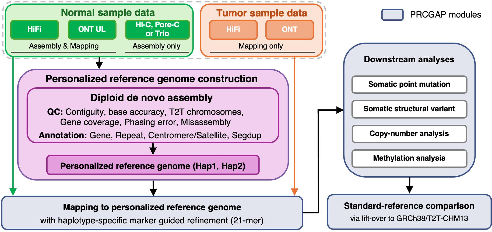

# Introduction

PRCGAP (<u>**P**</u>ersonalized <u>**R**</u>eference genome-based <u>**C**</u>ancer <u>**G**</u>enome <u>**A**</u>nalysis <u>**P**</u>ipeline) is a Snakemake workflow for comprehensive cancer genome analysis on a personalized reference genome (a phased de novo assembly of the same individual) using long-read sequencing data (PacBio HiFi and Oxford Nanopore Technologies).

## Overview

- Performs somatic variant calling (point mutations and structural variants), copy-number profiling, and DNA methylation analysis against a personalized reference genome.
- **Inputs:** a tumor / normal pair of long reads (**HiFi, ONT, or both**; bam or fastq.gz), plus the corresponding hap1 / hap2 assembly FASTAs and a one-time set of public references.
- **Self-contained annotation:** PRCGAP builds the per-assembly annotation it needs (gene models, centromeric satellites, LINE-1, tandem repeats, and liftover chains) from the assembly itself, so a run does not depend on any upstream annotation pipeline.
- **Outputs:** point mutation, structural variant (SV), copy number, and methylation callsets, each annotated against gene / repeat / centromere / segdup / gnomAD references and lifted to GRCh38 / CHM13 for variants.

## Getting started

The shortest path is [Quick start](./QuickStart.md): clone, pull the container images, fetch the references once, then hand `setup_workflow.py` your reads, your assembly, and the references. Nothing else is required.

Two things you may want beyond that:

- **The assembly itself.** PRCGAP does not assemble; generate the phased haplotype FASTAs with Hifiasm or Verkko; see [Preparation §1](./Preparation.md#_1-de-novo-assembly-required).
- **Deeper annotation.** RepeatMasker, segmental duplications, cenSat satellite subtypes, and per-haplotype misassembly tracks. These add columns to the SV and SNV/INDEL tables and are entirely optional; the companion [assembly_workflow](https://github.com/yos-sk/assembly_workflow) pipeline produces them. See [Preparation §3](./Preparation.md#_3-optional-deeper-annotation).

## Analysis modules

| Module | Description | Status | Used in the paper | Container image |
|--------|-------------|--------|-------------------|-----------------|
| Assembly annotation | Gene models (liftoff), centromeric satellites (dna-brnn), LINE-1, tandem repeats, and assembly → GRCh38 / CHM13 chain files, built from the assembly | Default | Yes, but imported from [assembly_workflow](https://github.com/yos-sk/assembly_workflow) rather than built in the workflow | `liftoff`, `dna_nn`, `chain_files`, `nanomonsv` |
| Bam_refiner | Align tumor / normal reads to the phased de novo assemblies | Default | Yes (HiFi and ONT) | `bam_refiner` |
| Methylation | Methylation calling for HiFi (pb-CpG-tools) and ONT (modkit) data | Default | Yes (HiFi) | `methylation` |
| Copynumber | Per-haplotype copy-number profiling, ploidy estimation, and plotting | Default | Yes (HiFi) | `copynumber` |
| Nanomonsv pipeline | parse → get → postprocess → insert classify, run separately per seqtype | Default | Yes; the reported SVs are the ONT calls | `nanomonsv`, `nanomonsv_postprocess` |
| ↳ connect / HiFi-ONT merge | Join fragmented SV calls; merge the HiFi and ONT callsets | Optional (off) | No | `nanomonsv`, `nanomonsv_postprocess` |
| Point mutation (DeepSomatic) | Somatic SNV/indel calling and post-processing | Default caller | Yes (HiFi, `PACBIO` model) | `deepsomatic`, `point_mutation_postprocess` |
| Point mutation (ClairS) | Somatic SNV/indel calling and post-processing (realignment / pileup / haplotyping) | Alternative (off; `--mutation-caller clairs` or `both`) | No | `clairs`, `point_mutation_postprocess` |
| SV annotation | Per-tumor / per-seqtype SV annotation (gene / RepeatMasker / centromere / segdup / kmer / liftover to GRCh38+CHM13 / gnomAD / misassembly) + SV type reclassification | Default | Yes, plus a comparison with GRCh38- / CHM13-based calls (paper only) | `annotation` |
| SNV / INDEL annotation | Per-tumor / per-tool / per-seqtype SNV+INDEL annotation (lifted coords / gene / RepeatMasker / centromere / segdup / misassembly / cross-tool check / gnomAD) | Default | Yes, plus a comparison with GRCh38- / CHM13-based calls (paper only) | `annotation` |

"Status" refers to the current release. "Used in the paper" refers to the analyses reported in the [PRCGAP paper](#citation); see [Configuration used in the paper](#configuration-used-in-the-paper) for details.

High-level dependencies between modules:

- Assembly annotation depends only on the assembly pair, so a tumor and its normal annotate once and share the result.
- `bam_refiner` outputs feed methylation, copynumber, nanomonsv, and the point-mutation callers.
- Raw caller output is passed to `point_mutation_postprocess` for realignment, pileup, and haplotyping.
- Nanomonsv runs independently per sequencing type; an optional final step merges HiFi and ONT.
- The post-processed Nanomonsv / DeepSomatic / ClairS callsets feed the annotation modules; SV reclassification additionally consumes the copynumber per-haplotype reference tables.
- Every imported annotation resource is optional; a missing input skips the corresponding column rather than failing the DAG.

## Sequencing types

A sample may carry HiFi, ONT, or both. Per-sample steps run for every sequencing type that sample has; tumor / normal steps run for every type present in **both** the tumor and its paired normal. Point mutations default to a single type (HiFi when both are present) and copy number always uses one. See [Usage → Sequencing types](./Usage.md#sequencing-types-hifi-only-ont-only-and-both).

## Configuration used in the paper

PRCGAP can run several alternative or optional paths. This section states which of them produced the results reported in the [paper](#citation), so that each result can be traced to a module and an output of the workflow.

The analyses in the paper were run with the shell-script implementation in the [`shell/`](https://github.com/yos-sk/PRCGAP/tree/v0.1.2/shell) directory of PRCGAP [release v0.1.2](https://github.com/yos-sk/PRCGAP/releases/tag/v0.1.2) (tag `v0.1.2`, commit `afae466`): `shell/run.sh`, with the module switches in `shell/conf.sh`, submitting jobs to SLURM. The copy-number analysis was run separately, with the same scripts that the release includes in `shell/scripts/copynumber/`. The annotation of the SV and point-mutation calls, including the SV reclassification, was done with the analysis scripts of the paper. These are the annotation scripts of the release (`workflow/scripts/annotate/`, run by [Workflow §8](./Workflow.md#_8-sv-annotation-reclassification) and [§9](./Workflow.md#_9-snv-indel-annotation)) with additional columns that compare each call with the GRCh38- and CHM13-based callsets; this comparison is specific to the paper and is not part of PRCGAP. The Snakemake workflow was re-implemented from these scripts. These pages describe the current Snakemake release; the differences that matter for the paper are listed at the end of this section.

| Analysis | Configuration used in the paper | Workflow step | Output (current layout) |
|----------|---------------------------------|---------------|-------------------------|
| Personalized reference | Phased Verkko assembly of the normal sample (hap1 + hap2) | Input; see [Preparation §1](./Preparation.md#_1-de-novo-assembly-required) | n/a |
| Read refinement | bam_refiner on tumor and normal reads, HiFi and ONT | [Workflow §1](./Workflow.md#_1-bam-refiner) | `bam_refiner/{sample}/{seqtype}/` |
| Point mutations | DeepSomatic on the tumor / normal **HiFi** BAMs with `--model_type=PACBIO`, PASS calls only, then `point_mutation_postprocess` for haplotype assignment | [Workflow §5](./Workflow.md#_5-point-mutation-calling-deepsomatic), [§7](./Workflow.md#_7-point-mutation-post-processing), [§9](./Workflow.md#_9-snv-indel-annotation) | `annotate_{snv,indel}/{tumor}/deepsomatic/hifi/` |
| Structural variants | Nanomonsv run on HiFi and on ONT separately. The SVs reported in the paper are the **ONT** calls; the HiFi calls were generated but not used. `connect` and the HiFi-ONT `merge` were not run. | [Workflow §4](./Workflow.md#_4-nanomonsv-pipeline-sv-calling), [§8](./Workflow.md#_8-sv-annotation-reclassification) | `annotate_sv/{tumor}/ont/` |
| Copy number | HiFi depth, per-haplotype reference tables, CBS segmentation, ploidy estimation | [Workflow §3](./Workflow.md#_3-copy-number) | `copynumber/{tumor}/output/` |
| Methylation | pb-CpG-tools on **HiFi** only. The ONT data of several cell lines carried no base-modification tags (`MM` / `ML`), so modkit could not be applied to the whole cohort. | [Workflow §2](./Workflow.md#_2-methylation) | `methylation/{sample}/hifi/output/` |
| Annotation | The annotation scripts of the release, run with the analysis scripts of the paper, which add a comparison with the GRCh38- and CHM13-based callsets. Gene, RepeatMasker, cenSat, segmental duplication and misassembly tracks from [assembly_workflow](https://github.com/yos-sk/assembly_workflow); liftover to GRCh38 and CHM13; gnomAD | [Workflow §8](./Workflow.md#_8-sv-annotation-reclassification), [§9](./Workflow.md#_9-snv-indel-annotation) | `annotate_sv/`, `annotate_snv/`, `annotate_indel/` |

ClairS was **not** used for any result in the paper. It is kept as an alternative caller for users, and the paper does not evaluate it.

The haplotype-specific k-mer ratio thresholds used in the paper (0.8 for point mutations, 0.6 for SVs) are not applied inside the workflow. The annotated tables report the k-mer ratio of each call, and the thresholds were applied when the tables were filtered for the analyses.

With the current release, the defaults reproduce the calling paths above. `--mutation-caller deepsomatic` and `--mutation-seqtypes primary` run DeepSomatic on HiFi alone when a pair has both HiFi and ONT. Nanomonsv still runs on every available seqtype, so use the `ont` SV table to match the paper.

Differences between the analysis in the paper and the current release:

- **Implementation.** The shell scripts submit one SLURM job per step with `sbatch` and turn each module on or off with a `TRUE` / `FALSE` variable in `conf.sh`. They cover read refinement through point-mutation post-processing ([Workflow §1](./Workflow.md#_1-bam-refiner)–[§7](./Workflow.md#_7-point-mutation-post-processing)); the annotation and SV reclassification of §8 and §9 are not part of them. The current release is a Snakemake workflow driven by the runner that `setup_workflow.py` generates.
- **Assembly annotation.** The shell scripts take the gene models and the satellite, LINE-1 and tandem-repeat BEDs as inputs in `conf.sh`; for the paper they came from [assembly_workflow](https://github.com/yos-sk/assembly_workflow). The current release builds them inside the workflow ([Workflow §0](./Workflow.md#_0-assembly-annotation)) unless you turn a step off and supply the file.
- **Copy-number depth.** The shell scripts compute bin depth with `samtools depth`; the current release uses `mosdepth`.
- **Point-mutation seqtypes and model.** The shell scripts run DeepSomatic on the HiFi BAMs only, with `--model_type=PACBIO` fixed. In the current release, `--mutation-seqtypes primary` (the default) selects HiFi when a pair has both, and the DeepSomatic model follows the seqtype.
- **Comparison with linear-reference calls.** The paper's annotation also compared each call with the GRCh38- and CHM13-based callsets. PRCGAP does not include this comparison.
- **ClairS switch.** The shell scripts turn ClairS on or off with `CLAIRS` in `conf.sh` (off in the template); the current release runs it only with `--mutation-caller clairs` or `both`.

## Table of contents

1. [Introduction](./Introduction.md): this page
2. [Quick start](./QuickStart.md): the shortest path from a clone to a finished run
3. [Usage](./Usage.md): installation, sample sheet, cluster profiles, bind mounts
4. [Options](./Options.md): every `setup_workflow.py` flag and `config.yaml` key
5. [Preparation](./Preparation.md): the de novo assembly, and the optional deeper annotation
6. [Workflow](./Workflow.md): modules, rule files, output layout
7. [Example](./Example.md): an end-to-end HG008 chr20 run, with the files it produces

## Contact

Yoshitaka Sakamoto
yosakam2@ncc.go.jp

## Citation

Sakamoto Y, Ochi Y, Kogure Y, Kato S, Sato-Otsubo A, Sugawa M, Tanaka Y, Tsujimura T, Mikami T, Nagae G, Chiba K, Okada A, Ito Y, Suzuki H, Aburatani H, Koga Y, Kato I, Takita J, Mano H, Ogawa S, Kataoka K, Kato M, Shiraishi Y. Personalized reference genome-based pipeline reveals comprehensive haplotype-resolved views of cancer genomes. *bioRxiv*. 2026. doi: [10.64898/2026.05.28.728591](https://doi.org/10.64898/2026.05.28.728591)
