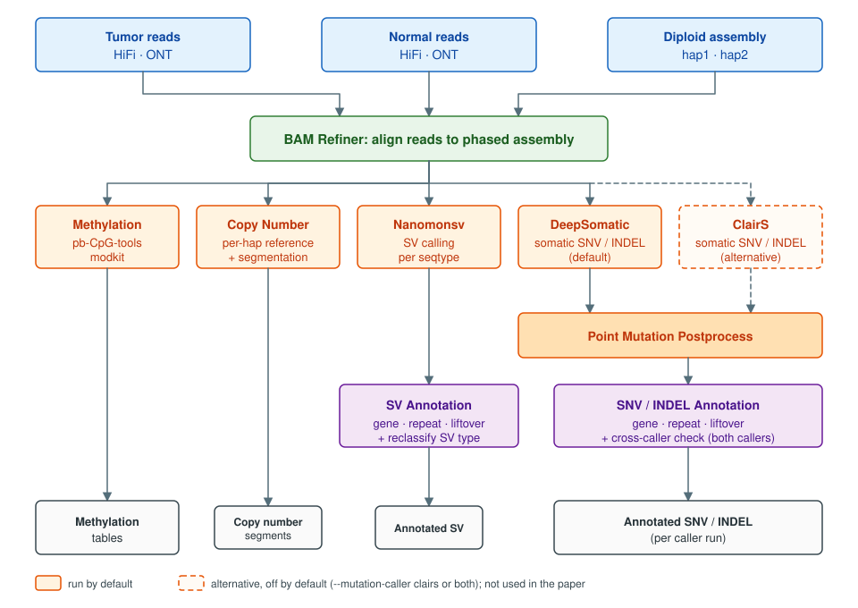

# Workflow

This page describes how PRCGAP is structured internally: the modules, their dependencies, the rule files that wire them together, and the output directory layout. The figure below gives the bird's-eye view; the **per-step descriptions** that follow walk through every block in the same top-to-bottom order.

## Workflow overview



> The figure above is a hand-curated, high-level summary — each rectangle corresponds to a module group rather than a single Snakemake rule. To inspect the full rule-level DAG for a specific configuration, run snakemake with `--rulegraph` (rule-only view) or `--dag` (per-sample / per-chromosome view; much larger) and pipe to Graphviz:
>
> ```bash
> snakemake \
>     --snakefile /path/to/PRCGAP/workflow/Snakefile \
>     --configfile /path/to/config.yaml \
>     --directory /path/to/output \
>     --rulegraph | dot -Tsvg > prcgap_rulegraph.svg
> ```

## Per-step description

The workflow has four layers — **(A) assembly annotation**, built from the assembly and the references; **(B) BAM refinement**, the foundation of every callset; **(C) per-tumor analysis modules** (methylation, copy number, SV, point mutations) which consume the refined BAMs; and **(D) annotation leaves** which consume the postprocessed callsets and the layer-A annotation.

### 0. Assembly annotation

**Scope:** per assembly pair (a tumor and its normal share one, so it is computed once). **Rule file:** `annotation.smk`.

PRCGAP builds the minimum annotation set it needs to interpret its own calls, so a run needs nothing beyond reads, the assembly, and the public references. Each per-haplotype step is its own rule, so hap1 and hap2 are submitted as concurrent jobs rather than looped inside one script.

| Rule(s) | Switch | Output | Consumed by |
|---------|--------|--------|-------------|
| `dna_brnn` (per hap) | `--run-dna-brnn` (on) | Alpha-satellite / HSat BED per haplotype | Copy number — masks the per-haplotype reference |
| `liftoff_reference` → `liftoff_hap` (per hap) → `liftoff_merge` | *always* | Gene GFF (tabix-indexed) + GTF on the assembly | SV / SNV / INDEL gene annotation, `nanomonsv insert_classify` |
| `prepare_mask_regions` → `chain_files_hap` (per hap × ref) → `chain_files_merge` | `--run-chain-files` (on) | Assembly → CHM13 and → GRCh38 chain files | SV / SNV / INDEL liftover, gnomAD |
| `line1_hap` (per hap) → `line1_merge` | `--run-line1` (on) | Full-length young LINE-1 (L1HS, L1PA2–5) BED | `nanomonsv insert_classify` — transduction source elements |
| `simple_repeat_hap` (per hap) → `simple_repeat_merge` | `--run-simple-repeat` (on) | ULTRA tandem-repeat BED (period ≤ 10) | `nanomonsv get` — drops indel-like SVs inside a repeat |

Notes on two of these:

- **LINE-1.** `insert_classify` needs the elements a transduction can originate from — the full-length young L1 set, not a general L1 annotation. RepeatMasker would produce it at hundreds of core-hours per sample; aligning the L1.3 query and typing the hits against Dfam's subunit models reproduces the same list in minutes. The reference set is described in `resource/line1/README.md`.
- **Chain files.** `prepare_mask_regions` masks satellite / centromere / GRC-exclusion regions out of CHM13 and GRCh38 first (and drops chrY for a female sample), then each haplotype is aligned to each masked reference and the two haplotype chains are concatenated per target.

`--no-run-<step>` turns a step off; you then supply that file through its config key instead. RepeatMasker, SEDEF segmental duplications, cenSat satellite subtypes, and misassembly tracks are **not** built here and remain optional config-supplied inputs — see [Preparation](./Preparation.md).

### 1. BAM Refiner

**Scope:** per sample, per seqtype (HiFi / ONT). **Rule file:** `bam_refiner.smk`.

Aligns tumor and normal reads to the phased de novo assemblies (`assembly_hap1`, `assembly_hap2`) and emits one refined BAM per `sample × seqtype`. A separate per-assembly k-mer step (`bam_refiner_kmer`) extracts haplotype-specific k-mer positions used to score haplotype assignment; it is computed once per assembly pair and shared by tumor and normal. Every downstream module consumes these BAMs, so this step is the foundation of the DAG.

### 2. Methylation

**Scope:** per sample, per available seqtype. **Rule file:** `methylation.smk`.

Methylation calling on the refined BAMs. HiFi reads are processed with `pb-CpG-tools`, which emits per-haplotype and combined tracks (BED + bigWig); ONT reads with `modkit`, which emits a single BED.

### 3. Copy Number

**Scope:** per tumor, on the primary shared seqtype. **Rule file:** `copynumber.smk`.

Split into a chain of rules so each piece is a separate job: `copynumber_reference` stages the reference, `copynumber_ref_table` (per haplotype) maps each haplotype onto CHM13 and `copynumber_ref_table_final` finalises the two reference tables, `copynumber_depth` computes per-bin depth, `copynumber_segment` performs CBS segmentation and estimates ploidy, and `copynumber_plot` renders the two-haplotype figure. Tumor ploidy is auto-estimated from the depth-ratio mode unless overridden.

The per-haplotype `ref.table` files are also what `reclassify_sv` (§8) consumes.

### 4. Nanomonsv pipeline (SV calling)

**Scope:** per tumor, independently per available seqtype. **Rule file:** `nanomonsv.smk`.

`parse → get → postprocess → insert classify` runs for each seqtype shared by the tumor and its normal:

- `parse` (tumor + normal) extracts candidate breakpoints from the refined BAMs.
- `get` calls SVs from the parsed pair, using the tandem-repeat BED to drop indel-like calls inside a repeat.
- `postprocess` filters and types the calls.
- `insert classify` types insertion events, using the liftoff GTF and the LINE-1 BED.
- `connect` (optional, `--run-nanomonsv-connect`) joins fragmented SV calls.
- `merge` (optional, `--run-nanomonsv-merge`) combines the HiFi and ONT callsets; only meaningful when both seqtypes are present.

Both optional steps are off by default and were not used in the paper.

### 5. Point mutation calling: DeepSomatic

**Scope:** per tumor, per called seqtype. **Rule file:** `deepsomatic.smk`.

The default caller. Somatic SNV / INDEL calling against the personalized reference. The work is scattered over contig chunks (`deepsomatic_scatter_setup` → `deepsomatic_chunks` → per-chunk jobs → `deepsomatic_merge`): contigs at least `--caller-solo-contig-min-bp` long get their own job, shorter ones are bundled.

### 6. Point mutation calling: ClairS

**Scope:** per tumor, per called seqtype. **Rule file:** `clairs.smk`.

The same role as DeepSomatic, scattered the same way, selected with `--mutation-caller clairs`. With `--mutation-caller both`, the two callsets stay separate through post-processing and are cross-checked during annotation (the `other` step in §9).

Which seqtypes the callers run on is controlled by `--mutation-seqtypes`: `primary` (default) uses one seqtype, HiFi when both are present; `all` uses every seqtype shared by tumor and normal.

### 7. Point mutation post-processing

**Scope:** per tumor, per tool, per called seqtype. **Rule files:** `clairs.smk`, `deepsomatic.smk` (postprocess rules).

Raw VCFs go through `point_mutation_postprocess`: `prepare` → `parse_vcf` → `realign` (local re-alignment of the candidate flanks) → `split_bed` → `pileup` (`samtools mpileup` over balanced chunks) → `haplotype` (haplotype-aware refinement). Output is `<tool>_post/{tumor}/{seqtype}/{tumor}.haplotyped.bed` together with the postprocessed VCF.

### 8. SV annotation + reclassification

**Scope:** per tumor, per seqtype. **Rule file:** `annotate_sv.smk` (+ the shared `gff_to_bed`).

- `gff_to_bed` — derives the SV gene BED from the liftoff GFF, once per assembly.
- `prep_sv` — filters the per-seqtype insert-classified table to PASS calls and extracts a breakpoint BED.
- `coordconv_sv_{grch38,chm13}` — lifts the breakpoint BED through the chain files (each step is skipped if its chain is empty).
- `annotate_sv_main` — appends gene → RepeatMasker → size → misassembly → kmer ratio → centromere → segdup → cross-seqtype (`other`) → gnomAD columns to the PASS table.
- `reclassify_sv` — reclassifies inter-contig SV directions on a CHM13-normalized basis using the per-haplotype copy-number reference tables from §3. It runs per seqtype, beside its own input, because it is the same product of the same (tumor, seqtype) as `annotated.txt`.

The `other` column cross-checks a call against the other seqtype's callset and is left blank when only one seqtype was analysed.

### 9. SNV / INDEL annotation

**Scope:** per tumor, per tool, per called seqtype, per mode (snv / indel). **Rule file:** `annotate_mut.smk`.

- `mut_vcf_index` — re-bgzips and tabix-indexes the postprocessed VCF, producing a single tabix-ready form that both `bed2vcf.py` and the `other` cross-tool check consume via `pysam.TabixFile`.
- `prep_mut` — splits `<tool>_post/{tumor}/{seqtype}/{tumor}.haplotyped.bed` into separate 14-column SNV and INDEL BEDs — the exact input format coordconv (SNV) and `bed2vcf.py` (INDEL) expect.
- **SNV liftover:** `coordconv_snv_{grch38,chm13}` lifts coordinates directly.
- **INDEL liftover:** `bed2vcf_indel` constructs a per-tool INDEL VCF, `indel_hap_reference` concatenates and indexes the hap1+hap2 FASTA as the source reference, and `liftvcf_indel_{grch38,chm13}` performs the allele-aware transanno lift.
- `annotate_mut_main` — runs the per-tool / per-mode chain in one shell wrapper (`scripts/annotate/annotate_mut.sh`): `add_lift_coords → gene → rmsk → size → misa → cen → segdup → other → check_unassigned → gnomad`. The `other` step cross-checks against the *other* tool's tabix-indexed VCF (clairs ↔ deepsomatic) and is blank when only one caller ran.

Gene annotation is restricted to each gene's MANE transcript when `--mane-summary` is supplied; without it, every protein-coding transcript over the site is reported.

`check_unassigned` replaces the earlier `check_homozygous` step: a somatic mutation is essentially never homozygous, and records that look homozygous are LOH, so collapsing the two haplotypes into one label would lose the haplotype assignment for no gain.

Every optional annotation writes its column even when its resource is absent, filled with the `-` placeholder, so the table's column positions stay invariant.

## Rule file map

PRCGAP's Snakemake rules live under `PRCGAP/workflow/rules/`. The workflow is composed by importing modular rule files:

| File | Role |
|------|------|
| `commons.smk` | Sample-sheet loading and validation, seqtype-availability helpers, resource lookups, annotation path resolution |
| `process.smk` | Top-level imports tying the rule files together |
| `annotation.smk` | In-workflow assembly annotation (dna-brnn, liftoff, chain files, LINE-1, tandem repeats) |
| `bam_refiner.smk` | Read alignment to the phased de novo assemblies (per sample, per seqtype) + k-mer extraction |
| `methylation.smk` | Methylation calling (HiFi: pb-CpG-tools; ONT: modkit) |
| `copynumber.smk` | Copy-number reference tables, depth, segmentation, ploidy, plot |
| `nanomonsv.smk` | nanomonsv parse / get / postprocess / insert classify / connect / merge |
| `deepsomatic.smk` | DeepSomatic calling (scattered) and post-processing |
| `clairs.smk` | ClairS calling (scattered) and post-processing |
| `annotate_sv.smk` | SV annotation (`gff_to_bed`, `prep_sv`, `coordconv_sv_*`, `annotate_sv_main`, `reclassify_sv`) |
| `annotate_mut.smk` | SNV / INDEL annotation (`mut_vcf_index`, `prep_mut`, `coordconv_snv_*`, `bed2vcf_indel`, `indel_hap_reference`, `liftvcf_indel_*`, `annotate_mut_main`) |

Tool-specific wrapper scripts live alongside in `PRCGAP/workflow/scripts/`, and JSON Schemas validating `config.yaml` and the sample sheet live in `PRCGAP/workflow/schemas/`. All annotation rules run inside the single `annotation` Singularity image.

The default target (`rule all`) enumerates the leaf outputs of every analysis path, per available sequencing type; Snakemake's DAG resolution pulls in everything upstream. HiFi-only and ONT-only samples work because the enumeration uses the seqtypes actually present — see [Usage → Sequencing types](./Usage.md#sequencing-types-hifi-only-ont-only-and-both).

## Output directory layout

All paths are relative to the run directory (`--output-dir`, passed to snakemake as `--directory`). `{seqtype}` is `hifi` or `ont`; `{tool}` is `clairs` or `deepsomatic`; `{tumor}` / `{normal}` are the sample names of the pair.

```
<output-dir>/
├── annotation/                                     # (0) in-workflow assembly annotation
│   ├── references/
│   │   ├── liftoff/GRCh38.{fa,fa.fai,gtf,gtf_db}    #     staged liftoff source
│   │   └── {GRCh38,chm13}.masked[_noY].fa{,.fai}    #     masked chain-file targets
│   └── {normal}/
│       ├── dna_nn/{normal}.hap{1,2}_dna-brnn.bed.gz{,.tbi}
│       ├── liftoff/{normal}.liftoff.gff.gz{,.tbi}
│       ├── liftoff/{normal}.liftoff.gtf.gz
│       ├── line1/{normal}.LINE1.bed.gz{,.tbi}
│       ├── simple_repeat/{normal}.simple_repeats.bed.gz{,.tbi}
│       └── chain_files/{normal}_to_{GRCh38,chm13}.chain
│
├── bam_refiner/{sample}/{seqtype}/                  # (1) refined BAMs per sample × seqtype
│   │   {sample}_bam_refined.sorted.bam{,.bai}
│   │   {sample}_kmer_ratio.txt
│   │   bam_refiner_result.tsv.gz, bam_refiner.log.gz
│   └── ../kmer/                                     #     haplotype-specific k-mers (once per assembly)
│       hap{1,2}_cnt_kmerposition.bed.gz{,.tbi}, hap{1,2}_list.txt.gz
│
├── methylation/{sample}/hifi/output/                # (2) pb-CpG-tools
│   │   {sample}_methylation.{combined,hap1,hap2}.bed.gz{,.tbi}
│   │   {sample}_methylation.{combined,hap1,hap2}.bw
│   └── ../../ont/output/                            #     modkit
│       {sample}_methylation.bed.gz{,.tbi}
│
├── copynumber/{tumor}/output/                       # (3) copy number
│       {tumor}.copynumber.png                       #     two-haplotype plot
│       {tumor}.hap{1,2}.copynumber.tsv              #     per-bin copy number
│       {tumor}.hap{1,2}.cbs.txt                     #     CBS segments
│       {tumor}.hap{1,2}.cbs.split.txt               #     segments split at assembly gaps
│       {tumor}.hap{1,2}.ploidy                      #     estimated (or overridden) ploidy
│       {normal}.hap{1,2}.ref.table                  #     assembly → CHM13 reference table
│
├── nanomonsv/{seqtype}/                             # (4) SV calling, per seqtype
│       {sample}.{bp_info,deletion,insertion}.sorted.bed.gz{,.tbi}    # parse, tumor + normal
│       {sample}.rearrangement.sorted.bedpe.gz{,.tbi}                 # parse, tumor + normal
│       {tumor}.nanomonsv.result.txt / .result.vcf                    # get
│       {tumor}.nanomonsv.supporting_read.txt, .sbnd.result.txt
│       {tumor}.simple_repeat_scores.tsv
│       {tumor}.nanomonsv.result.filt.txt                             # postprocess
│       {tumor}.nanomonsv.new_result.sv_typed.txt
│       {tumor}.nanomonsv.{group,pair}_info.txt
│       {tumor}.nanomonsv.new_result.sv_typed.insert_classified.txt   # insert classify
├── nanomonsv/{tumor}.nanomonsv.result.merged.txt    #     only with --run-nanomonsv-merge
│
├── {tool}/{tumor}/{seqtype}/output.vcf.gz{,.tbi}    # (5,6) raw caller output
├── {tool}_post/{tumor}/{seqtype}/                   # (7) post-processed point mutations
│       {tumor}.haplotyped.bed                       #     the callset downstream annotation reads
│       output.vcf.gz, output.tabix.vcf.gz{,.tbi}
│       pileup/{tumor}_pileup.bed.gz{,.tbi}
│       realign/realign.bam{,.bai}, realign/parsed_vcf.bed
│       haplotyping.log
│
├── annotate_common/{normal}/liftoff.gene.bed.gz{,.tbi}   # (8) shared gene BED
├── annotate_sv/{tumor}/{seqtype}/                   # (8) SV annotation
│       {tumor}.PRCGAP.nanomonsv_results.annotated.txt
│       {tumor}.PRCGAP.nanomonsv_results.annotated_gnomad.txt
│       {tumor}.PRCGAP.nanomonsv_results.reclassified.txt   # ← the final SV table
│
├── annotate_snv/{tumor}/{tool}/{seqtype}/           # (9) SNV annotation
│       {tumor}.{tool}.snv.annotated.txt
├── annotate_indel/{tumor}/{tool}/{seqtype}/         # (9) INDEL annotation
│       {tumor}.{tool}.indel.annotated.txt
│
├── benchmarks/<module>/...                          # per-rule wall time / peak RSS (TSV)
└── logs/
    ├── <module>/...                                 # per-rule logs
    └── slurm/<rule>/<jobid>.{out,err}               # scheduler logs (profile-dependent)
```

### Final callsets

The leaves worth looking at first:

| Result | Path |
|--------|------|
| Copy-number plot | `copynumber/{tumor}/output/{tumor}.copynumber.png` |
| Copy-number segments | `copynumber/{tumor}/output/{tumor}.hap{1,2}.cbs.txt` |
| Structural variants | `annotate_sv/{tumor}/{seqtype}/{tumor}.PRCGAP.nanomonsv_results.reclassified.txt` |
| SNVs | `annotate_snv/{tumor}/{tool}/{seqtype}/{tumor}.{tool}.snv.annotated.txt` |
| INDELs | `annotate_indel/{tumor}/{tool}/{seqtype}/{tumor}.{tool}.indel.annotated.txt` |
| Methylation (HiFi) | `methylation/{sample}/hifi/output/{sample}_methylation.hap{1,2}.bed.gz` |
| Methylation (ONT) | `methylation/{sample}/ont/output/{sample}_methylation.bed.gz` |
| Refined BAM | `bam_refiner/{sample}/{seqtype}/{sample}_bam_refined.sorted.bam` |

### Scratch removed on success

Once every target is built, PRCGAP deletes the intermediates a finished run no longer needs and prints what it removed:

- every `workspace/` directory (copy number, annotation, methylation, SV / SNV / INDEL annotation),
- the caller scatter directories `{tool}_scatter/{tumor}/{seqtype}/`,
- `bwa_index/`,
- `copynumber/reference/`,
- the per-rule copies of `reference.fa`, and a handful of nanomonsv and realign side products.

A failed or interrupted run keeps all of it for inspection. `setup_workflow.py --debug` keeps it unconditionally. Everything removed is reproducible from the inputs that remain; only `copynumber/reference/` is a declared output, and restaging it is seconds of work.

## Where to look when something goes wrong

- Per-rule logs: `<output-dir>/logs/<module>/<sample>_<...>.log` — this is where the tool's own stdout/stderr goes.
- Per-rule benchmarks: `<output-dir>/benchmarks/<module>/...` — wall time and peak RSS, useful when a rule is being OOM-killed.
- Snakemake driver log: `<output-dir>/.snakemake/log/`.
- Cluster job stderr/stdout: wherever your profile's `cluster_logpath` points (`logs/slurm/<rule>/<jobid>.{out,err}` with the default SLURM template). The driver job's own log goes to `log/` next to the runner script.
- Validation errors from `config.yaml` / the sample sheet: the messages come from the schemas in `PRCGAP/workflow/schemas/`.
- Rules failing with "no such file" inside a container almost always mean a missing bind mount — see [Usage → `--singularity-bind`](./Usage.md#bind-mounts).

For the practical command sequence and a worked example, see [Example](./Example.md).
